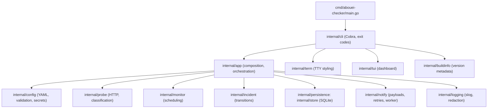

# Architecture

## Overview

AboueiChecker is a single-process Go CLI. The authoritative design lives in
`docs/architecture.md` and the ADRs in `docs/decisions/`; this file maps the
dependency direction and package responsibilities for newcomers.

## Rules

1. `cmd/` is a thin entry point: parse, delegate, exit.
2. `internal/cli` owns flags, help, JSON envelopes, and exit-code mapping.
   It never implements probing, transitions, SQL, or delivery.
3. `internal/app` orchestrates use cases (`Check`, `Monitor`, `Status`,
   `History`, retention) through narrow dependencies. It never renders
   terminal output.
4. Domain rules (`probe` classification, `incident` transitions) do not
   import Cobra, terminal styling, SQLite, or webhook transport.
5. `internal/store` is the only package that talks SQLite. Application
   code uses its repositories; schema and migrations stay inside.
6. `internal/notify` builds payloads and delivers webhooks; it never opens
   incidents or touches threshold state.
7. `internal/term` and `internal/tui` are presentation only. JSON output
   paths never touch them (no banners, no ANSI in machine output).
8. Secrets flow from `${ENV}` through `config` resolution and are redacted
   in errors, logs, envelopes, and payloads. Raw response bodies are never
   logged or persisted beyond bounded summaries.
9. Concurrency: per-backend schedulers never overlap a backend's own
   probes; a global semaphore caps parallelism; SQLite writers converge
   through WAL + busy timeout + bounded transient retry
   (see `internal/store/store.go`).

## Data flow: one probe

Probe → `ProcessResult` (observation + streak + incident + outbox in one
transaction) → `deliverDue` (claim, send, mark terminal/retryable) →
presentation (human line or JSON envelope) with the documented exit code.

## Testing seams

Business rules are testable without terminals, networks, or databases:
`httptest` doubles for HTTP, temp SQLite for persistence, buffer writers
for CLI output, and `runDashboard`/`isInteractive` seams for the TUI
entry path. Cross-component proofs live in `internal/integration/`.
