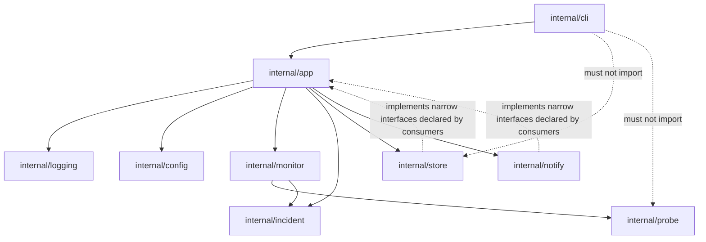

# Architecture Overview

| Field | Value |
| --- | --- |
| Status | Phase 1 shared foundation implemented; only `version` is operational |
| Audience | Contributors and maintainers |
| Related | [Requirements](requirements.md), [Configuration](configuration.md), [CLI contract](cli-contract.md), [Incident lifecycle](incident-lifecycle.md), [Persistence](persistence.md) |

## 1. Design Goals

The architecture is a modular Go application with a small number of explicit
boundaries:

- Command-line presentation is isolated from application behavior.
- HTTP probing, incident transitions, persistence, and webhook delivery can be
  tested independently.
- Domain and application logic do not depend on Cobra, SQLite, or the webhook
  transport.
- Dependencies point inward toward stable types and orchestration.
- Concurrency and resource ownership are explicit.
- Errors preserve their cause and never leak secrets.

This is pragmatic layering, not a full Clean Architecture or DDD framework. There
is no plugin system, dependency-injection container, generic repository
abstraction, or interface for every struct.

## 2. Current Phase 1 Implementation

The repository currently contains:

```text
cmd/abouei-checker/       process entry point and signal context
internal/app/             composition root, global options, shared errors
internal/buildinfo/       linker-injected build metadata
internal/cli/             Cobra command tree, global flags, rendering, exit mapping
internal/logging/         slog handlers, level/format parsing, redaction boundary
```

Only `version` performs work. The CLI accepts `--config` and `--log-level` for
every command, but `--config` is not read until Phase 2. The package layout below
describes intended ownership for later phases; empty placeholder packages are
deliberately not created.

## 3. Planned Package Ownership

| Package | Responsibility | Must not contain |
| --- | --- | --- |
| `cmd/abouei-checker` | Process entry, signal context, wiring of stdin/stdout/stderr, exit | Business logic, Cobra command definitions |
| `internal/cli` | Command tree, flags, help, human/JSON rendering, exit-code mapping | Scheduling, HTTP, SQLite, webhook delivery |
| `internal/app` | Composition root, global options, logger wiring, build metadata, shared error categories | Cobra types, SQL, transport details |
| `internal/logging` | `slog` handler configuration, level/format parsing, safe-field and redaction rules | Command behavior, configuration loading, network or persistence |
| `internal/config` | Discovery, bounded reading, expansion, strict decoding, defaults, validation, immutable runtime config | Database access, network calls |
| `internal/probe` | Safe HTTP client, request construction, status/body criteria, result types | Incident policy, persistence, Cobra |
| `internal/monitor` | Per-backend scheduling, global concurrency, no-overlap enforcement, probe result dispatch | Webhook payloads, SQL |
| `internal/incident` | Threshold evaluation, incident transitions, event identity, reminder policy | HTTP clients, SQL, CLI output |
| `internal/notify` | Webhook payload encoding, HTTP delivery, retry classification, idempotency header | Incident transitions, config storage |
| `internal/store` | SQLite connection, migrations, transactions, queries, outbox persistence | Business rules, HTTP, CLI |
| `internal/buildinfo` | Build-time version metadata | Runtime state |

Packages are added when their first real implementation lands. A package may be
split if it develops more than one clear responsibility, but abstractions are not
introduced for hypothetical future databases or transports.

### Dependency direction



Rules:

1. `internal/cli` may depend on `internal/app`, `internal/buildinfo`, and the
   command framework. It must not import SQLite, HTTP probe, or webhook
   packages.
2. `internal/app` orchestrates; it is the only package that wires config,
   monitoring, incident policy, storage, and notification delivery together.
3. `internal/probe`, `internal/incident`, and `internal/config` have no
   dependency on persistence or delivery.
4. `internal/store` may map between database rows and domain types. It does not
   make incident decisions.
5. `internal/notify` receives an immutable notification event value. It does not
   read configuration files or decide whether an alert should exist.
6. Interfaces are declared where they are consumed (primarily `internal/app`)
   and kept narrow. Concrete types are used elsewhere.
7. No package imports `internal/cli` except `cmd/abouei-checker`.
8. There are no circular dependencies.
9. `internal/logging` does not import application or CLI packages. Application
   and future domain packages may use it for logger construction and redaction.
10. Shared application errors live in `internal/app`; `internal/cli` maps their
    categories to exit codes. Domain packages return ordinary errors that the
    application boundary classifies.

## 4. Domain and Application Boundaries

### Core value types

- **Probe result:** backend identity, observed timestamp, outcome
  (`healthy`/`failed`), HTTP status, duration, safe failure reason, optional
  safe error summary.
- **Incident snapshot:** incident ID, backend ID, state (`open`/`closed`),
  timestamps, failure/recovery counts.
- **Notification event:** durable event ID, incident ID, event type, sequence,
  occurred time, and a secret-free payload snapshot.
- **Health policy:** accepted status set, optional body condition, interval,
  timeout, failure threshold, recovery threshold, concurrency limit.

These are ordinary Go values owned by the package that defines their behavior
(`probe`, `incident`, `config`). There is no central `models` or `domain`
catch-all package.

### Application orchestration

`internal/app` owns the lifecycle:

- Load and validate configuration.
- Resolve secret references and construct components.
- Open and migrate SQLite.
- Reconcile persisted state on startup.
- Execute a one-shot check or run the continuous monitor.
- Coordinate transaction boundaries: an observation, backend threshold state,
  incident transition, and outbox event for one backend are committed together.
- Trigger notification attempts without putting network I/O inside a database
  transaction.
- Render command results through an output boundary.
- Handle cancellation and graceful shutdown.

## 5. Runtime Lifecycle

### 5.1 One-shot `check`

```text
parse CLI
  -> discover/load/expand/validate config
  -> open DB, apply pragmas, migrate
  -> load backend state and open incidents
  -> probe selected backends concurrently
  -> persist each result + threshold state + incident/outbox changes atomically
  -> attempt due notification events once
  -> render summary (text or JSON)
  -> close DB
  -> choose exit code
```

One-shot checks are not a scheduler. They evaluate each selected backend exactly
once. Due reminders that already exist can be attempted during the invocation,
but no future reminder is scheduled by a process that exits.

### 5.2 Continuous `monitor`

```text
parse CLI
  -> load config and DB
  -> reconcile open incidents and backend state
  -> immediately probe all configured backends
  -> start per-backend schedules and one notification worker
  -> on SIGINT/SIGTERM: stop scheduling, cancel in-flight work, wait
     up to runtime.shutdown_timeout, close DB, exit 0
```

Individual unhealthy results do not terminate `monitor`. Fatal persistence or
startup failures do. A forced second signal terminates with the conventional
Unix `128+signal` code. Pending webhook events remain durable across shutdown and
are retried on the next process start.

### 5.3 Commands without a database

`version` and `init` do not require configuration or a database. `validate`
loads and validates configuration but does not open SQLite, probe endpoints, or
deliver notifications. `status` and `history` open the database read-only in
behavioral terms; they do not probe or create notifications.

## 6. Configuration Flow

```text
--config PATH
  -> else ABOUEI_CONFIG
  -> else ./abouei.yaml
  -> else <user-config-dir>/abouei-checker/config.yaml
  -> bounded read
  -> YAML decode with unknown fields rejected
  -> expand ${NAME} references from the process environment
  -> apply documented defaults
  -> validate cross-field rules
  -> immutable runtime configuration
```

Configuration is loaded once per process. There is no hot reload in v1. Relative
database paths resolve against the directory containing the configuration file.
Secrets are resolved at load time and are never included in logs or rendered
configuration. The canonical schema and failure behavior are in
[configuration.md](configuration.md).

## 7. Monitoring and Incident Lifecycle (Conceptual)

1. The scheduler invokes a probe for a backend. The same backend never has two
   probes in flight.
2. The probe returns a normalized result. Network errors, timeouts, non-accepted
   status codes, body mismatches, and response-size violations are failed
   results, not internal errors.
3. The result is persisted as an observation.
4. The persisted threshold state is updated:
   - failure increments the consecutive-failure streak and resets recovery;
   - success increments the recovery streak and resets failure.
5. The incident policy is evaluated in the same transaction:
   - reaching the failure threshold opens an incident and enqueues a Down event;
   - reaching the recovery threshold closes it and enqueues a Recovery event;
   - an open incident remains open while results fluctuate below thresholds.
6. Reminder scheduling is updated while the incident remains open.
7. After commit, the notification worker claims due outbox events and attempts
   delivery. Network failure never rolls back the incident transition.

The exact state machine, thresholds, identity rules, and reminder semantics are
in [incident-lifecycle.md](incident-lifecycle.md).

## 8. Persistence Boundary

SQLite is the source of truth for runtime history and recovery state:

- observations;
- per-backend consecutive failure/recovery state;
- incidents;
- durable notification events and their delivery state;
- minimal metadata required for retention.

Configuration remains the source of truth for backend definitions and policy.
Backend IDs reference configuration identities; the database does not store an
authoritative copy of URLs, headers, or secrets.

The store uses one writer connection initially to avoid `SQLITE_BUSY`
complexity. WAL mode permits read queries without blocking the writer. All state
transitions for one probe are transactional. Migrations are embedded,
forward-only, and tracked with `PRAGMA user_version`. Details and proposed DDL
are in [persistence.md](persistence.md).

## 9. Notification Boundary

Incident transitions create durable events; delivery is separate.

- Event creation and incident state change share a transaction.
- A single notification worker claims due events and delivers JSON over HTTP.
- Retry classification, backoff, and `Idempotency-Key` are defined in the
  incident contract.
- Delivery is at-least-once. The system never claims exactly-once.
- A crash after the receiver processes a request but before the local delivery
  status is committed may cause a duplicate with the same event ID.
- Notification payloads contain backend IDs/names, incident metadata, and safe
  error context. They never contain request headers, secrets, response bodies,
  or full URLs with credentials.

The worker is not implemented in Phase 0.

## 10. Error Handling

- Errors are wrapped with `%w` and contextual messages that preserve the cause.
- Expected application failures use `internal/app.Error`, which carries a
  category, a stable code, a safe user-facing message, and an optional internal
  cause. `Error()` and `SafeMessage()` never render the cause.
- User-facing errors name the field or operation, not secret values.
- Probe failures are data, not process errors. A timeout is an observation and
  may lead to an incident; an unreadable database is an operational error.
- The CLI maps categories to the stable exit-code categories in
  [cli-contract.md](cli-contract.md). Cobra parse/validation errors are classified
  as usage at the execution boundary; unclassified command errors default to
  internal. Cobra does not call `os.Exit` directly.
- Application code returns errors; only `cmd/abouei-checker` converts the final
  exit code to the process status.
- Database corruption or a newer schema fails closed. The application never
  deletes or recreates a database automatically.
- Notification delivery failure is persisted with a safe error summary and does
  not corrupt incident state.

## 11. Logging

Logging uses `log/slog` with `DEBUG`, `INFO`, `WARN`, and `ERROR` levels.

- Destination: stderr. Application logs never write to stdout.
- Format: text by default; JSON is supported through the logging API and will be
  selected by `logging.format` when Phase 2 adds configuration loading. Phase 1
  does not expose a separate format flag.
- Default level: `info`. `--log-level` overrides it case-insensitively for one
  invocation; future configuration supplies `logging.level`.
- Timestamps are UTC and use a fixed RFC3339 format with milliseconds. Stable
  field names include `component`, `command`, `backend_id`, `operation`,
  `duration_ms`, `http_status`, `failure_reason`, `outcome`, `attempt`,
  `error_category`, and `error_code`.
- `internal/logging` enforces an allowlist of safe field names. Unknown fields,
  groups, maps, structs, and non-error `any` values have their values redacted.
  Resolved secrets registered with the redactor are replaced literally, and URL
  userinfo/query strings, cookies, bearer/basic credentials, and secret
  assignments are normalized as a defense-in-depth backstop.
- Logs never include header values, secret references, response bodies, webhook
  tokens, URL userinfo, or query strings that may carry credentials.
- stdout is reserved for command results and JSON output. Logs must not corrupt
  machine-readable stdout.

The logger is created in `internal/app` with an injected writer. Its construction
and redaction behavior are tested independently in `internal/logging` and
`internal/app`. See [ADR-0005](decisions/0005-logging-error-boundaries.md) and the
safe-logging boundaries in [security.md](security.md#10-logging-and-error-handling).

## 12. Concurrency and Resource Ownership

- Each backend has at most one probe in flight.
- Independent backends run concurrently under
  `runtime.max_concurrent_probes` (default 8).
- Scheduling is start-to-start. If a probe overruns its interval, the next probe
  starts immediately after completion rather than overlapping.
- Contexts propagate cancellation to HTTP requests, body reads, database work,
  and the notification worker.
- Every response body is closed. Reads are bounded by
  `max_response_bytes`.
- HTTP clients are constructed once and reused; transports are closed when the
  process exits.
- SQLite has one writer connection; transactions are short and never include
  network calls.
- The notification worker is serialized per incident to preserve event order.
  Different incidents may be delivered concurrently only after a documented
  concurrency limit exists.
- Graceful shutdown waits up to `runtime.shutdown_timeout`, then cancels
  remaining work. Durable state is committed or abandoned atomically; partial
  writes are not patched in memory.

## 13. Security and Trust Boundaries

- Configuration and environment variables are trusted operator inputs.
- Monitored endpoints and webhook receivers are untrusted network peers.
- SQLite is a local trusted data store with restrictive file permissions.
- Monitoring private networks is an intended use case, so private IP addresses
  are not categorically blocked. Operators must not accept configuration from
  untrusted parties. See [security.md](security.md#6-ssrf-and-network-trust).
- TLS verification is always enabled by default; there is no
  `insecure_skip_verify` configuration in v1.
- Backend probes and webhook calls use explicit timeouts, response limits, and
  redirect policy.
- Secrets are resolved just in time and redacted at every output boundary.

## 14. Build and Distribution Architecture

- One Go module, one executable.
- Static, CGO-disabled builds for the declared platform matrix.
- `-trimpath` and linker-injected version, commit, and build date.
- Docker multi-stage build; scratch runtime; numeric non-root UID `65532`;
  CA certificates copied from the build stage; data mounted at `/data`; config
  mounted read-only at `/etc/abouei/abouei.yaml`.
- No secrets, configuration, or database inside the image.
- CI compiles every target and builds/runs the container. Release runtime
  validation is a separate Phase 7 gate, because compilation is not runtime
  proof.

## 15. Architecture Constraints Checklist

- [x] Domain/application logic independent of Cobra.
- [x] Network and database implementation behind package boundaries.
- [x] No global mutable state.
- [x] Explicit dependency injection at `internal/app`.
- [x] No plugin framework or DI container.
- [x] No generic database abstraction.
- [x] No per-struct interface ceremony.
- [x] Context cancellation and resource ownership documented.
- [x] Concurrency assumptions documented.
- [x] Standard library preferred; dependencies justified in ADRs.
- [x] Secrets excluded from logs, errors, JSON, and notifications by contract.
