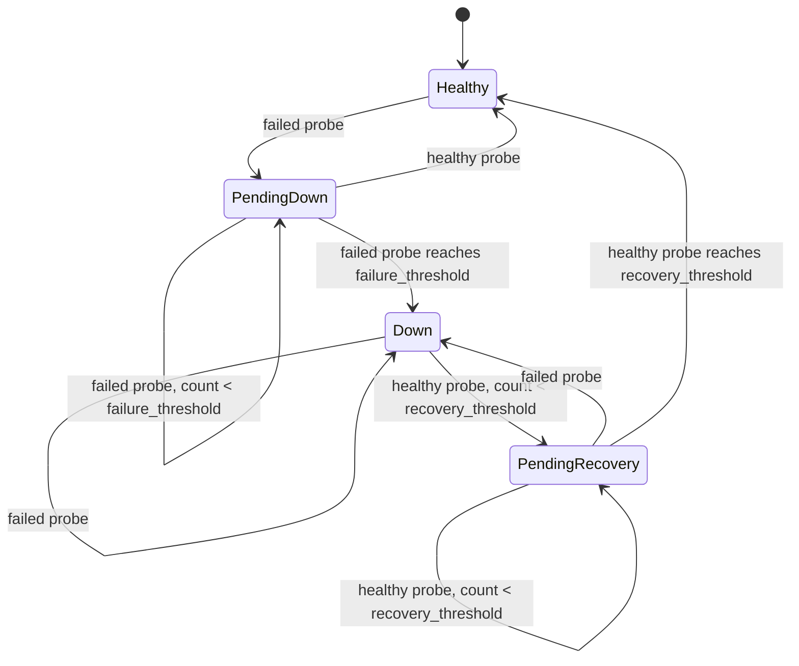

# Incident Lifecycle and Notification Contract

| Field | Value |
| --- | --- |
| Status | Phase 4 implementation contract; threshold state machine, reminders, payload, and retry policy implemented |
| Related | [Configuration](configuration.md), [Persistence](persistence.md), [CLI contract](cli-contract.md), [Security](security.md) |

This document defines the semantics that Phase 3 and Phase 4 must implement. It
is not a claim that an incident state machine or webhook worker exists. The
current Phase 0 executable only supports `version`.

## 1. Terms

- **Probe result:** the outcome of one HTTP request: healthy or failed, with a
  safe failure reason, status code, duration, and timestamp.
- **Observation:** a persisted probe result.
- **Failure streak:** consecutive failed probes for a backend.
- **Recovery streak:** consecutive healthy probes for a backend with an open
  incident.
- **Incident:** a confirmed outage with a stable identity and lifecycle.
- **Notification event:** a durable, addressable record requesting webhook
  delivery for an incident transition or reminder.
- **Fresh event:** an event created by a transition in the current invocation.
  Pending events from an earlier process may also be due.

An individual failed request is never an incident by itself. It increments the
failure streak and may produce exit code `1` for `check`, but only the configured
threshold opens an incident.

## 2. Public States

| Public state | Persisted incident? | Meaning |
| --- | --- | --- |
| `healthy` | No | No open incident; failure streak is zero |
| `pending_down` | No | At least one failure, below the Down threshold |
| `down` | Yes, open | Failure threshold reached; incident is open |
| `pending_recovery` | Yes, open | Open incident with at least one success, below the recovery threshold |
| `unknown` | No | No observation/state exists yet |
| `orphaned` | Yes, open | Open incident whose backend ID is no longer in configuration |

`down` and `pending_recovery` are both shown as Down externally because the
incident remains open. `pending_down` is not an incident and must not produce a
Down notification.

## 3. Thresholds and State Transitions

Each backend has two configured thresholds:

- `failure_threshold` (default `3`): consecutive failed probes required to open
  an incident.
- `recovery_threshold` (default `1`): consecutive healthy probes required to
  close an open incident.

Threshold state is persisted per backend in SQLite, including across one-shot
invocations and restarts. A restart must not reset a failure or recovery streak.



Transition rules on each probe result:

1. **Failed result**
   - Reset the recovery streak to zero.
   - Increment the failure streak.
   - If no incident is open and the failure streak reaches
     `failure_threshold`, open an incident and enqueue `incident.opened` if the
     effective policy enables Down notifications.
   - If an incident is already open, keep it open and update its last failure
     metadata. Do not enqueue another Down event.
2. **Healthy result**
   - Reset the failure streak to zero.
   - If no incident is open, remain healthy; recovery streak is not used.
   - If an incident is open, increment the recovery streak. Once it reaches
     `recovery_threshold`, close the incident and enqueue `incident.recovered` if
     the policy enables Recovery notifications.
3. **Threshold of 1**
   - A single failed probe opens the incident immediately.
   - A single healthy probe closes it immediately.
4. **Backend removed from configuration**
   - A persisted open incident becomes `orphaned`.
   - It is not probed, reminded, or auto-closed, because doing so would fabricate
     a recovery that was never observed. It remains visible in `status` and
     `history`.
5. **Backend re-added with the same ID**
   - Persisted backend state and an open incident resume. This is why IDs must be
     stable and must not be reused for a different service.

Threshold evaluation and persistence are atomic for a single probe. See
[persistence.md](persistence.md).

## 4. Incident Identity

- Incident IDs are UUIDv4 strings generated with `crypto/rand` at incident open.
- Notification event IDs are independent UUIDv4 strings.
- Each incident has a monotonically increasing event `sequence` starting at `1`.
- Timestamps are stored in UTC. SQLite stores Unix milliseconds; JSON/RFC3339
  renders UTC timestamps.
- The following incident timestamps are required:
  - `opened_at` — moment the failure threshold was confirmed.
  - `first_failure_at` — first failure in the streak that led to the incident.
  - `last_failure_at` — most recent failed observation while open.
  - `resolved_at` — moment recovery was confirmed; null while open.
- An incident ID is never reused.
- A new outage after recovery receives a new incident ID and resets the event
  sequence to `1`.

## 5. Event Types and Sequences

| Event type | Sequence | When created | Payload status |
| --- | --- | --- | --- |
| `incident.opened` | `1` | Failure threshold reached | `down` |
| `incident.reminder` | `2..n` | Reminder becomes due while open | `down` |
| `incident.recovered` | next unused | Recovery threshold reached | `healthy` |

- The sequence is unique per incident. A unique database constraint enforces it.
- Sequence `1` is reserved for `incident.opened` even when Down notifications are
  disabled; in that case the first reminder uses sequence `2`. This keeps the
  event sequence meaningful without inserting a disabled event row.
- Reminder sequences depend on how many reminders were actually enqueued.
- The recovery event uses the next sequence, not a fixed number.
- Event creation is part of the same transaction as the incident transition.
  There is no window in which an incident exists without its queued event if the
  policy enables that event.
- If a notification type is disabled by policy, no event row is created for it.

## 6. Notification Policy and Reminders

Policy is inherited from `defaults.notifications` and can be overridden per
backend as described in [configuration.md](configuration.md#57-notifications).

Effective policy is evaluated at transition time:

- `enabled: false` suppresses all webhook events for that backend. Incident and
  history state are still recorded.
- `notify_on_down: true` emits `incident.opened`.
- `notify_on_recovery: true` emits `incident.recovered`.
- `reminder_interval > 0` enables reminders while the incident remains open.
- `reminder_max` limits the number of reminder events after the initial Down
  event. `0` means unlimited.

### 6.1 Reminder scheduling

- First reminder is due at `opened_at + reminder_interval`.
- Subsequent reminders are scheduled relative to the time a reminder is
  enqueued, not every missed interval. This avoids a flood after downtime.
- At most one reminder event for an incident may be pending or in retry at a
  time.
- A new reminder is not enqueued while any earlier event for that incident is
  pending, delivering, or dead. Reminders resume only after prior delivery is
  terminal (`delivered`) or the incident closes.
- When a due reminder is enqueued, `next_reminder_at` becomes
  `now + reminder_interval`; missed slots are skipped.
- On restart, if `next_reminder_at` is in the past and the incident is still open,
  at most one reminder is enqueued immediately. The next interval starts from
  that enqueue time.
- When an incident closes:
  - future reminders are canceled;
  - any queued but not-yet-delivering reminder is marked `canceled` rather than
    delivered;
  - a reminder already in flight may still reach the receiver, but it carries
    the original incident sequence and can be ignored by an idempotent consumer.
- One-shot `check` can enqueue an already-due reminder, but does not schedule
  future checks. Continuous `monitor` is required for reliable reminder cadence.

### 6.2 Reminder cap

`reminder_max` counts reminders after the Down event. Example: `reminder_max: 6`
allows up to six `incident.reminder` events. A recovery still emits its event
regardless of the cap.

## 7. Webhook Payload Contract

Payload schema version: `1`. The payload is a stable, versioned JSON object.
Consumers should ignore unknown fields and deduplicate by `event_id`.

### 7.1 Example: Down

```json
{
  "schema_version": "1",
  "event_id": "8a4d8f8e-7a41-4ac0-9f39-4e1f72d1a0d1",
  "event_type": "incident.opened",
  "sequence": 1,
  "occurred_at": "2026-10-22T12:00:00Z",
  "backend": {
    "id": "example-api",
    "name": "Example API"
  },
  "incident": {
    "id": "7c2c1f5e-42f2-4f96-9b1d-30a5d70fbd0f",
    "status": "down",
    "opened_at": "2026-10-22T12:00:00Z",
    "first_failure_at": "2026-10-22T11:57:00Z",
    "resolved_at": null,
    "failure_count": 3,
    "recovery_count": 0,
    "last_failure_at": "2026-10-22T12:00:00Z",
    "last_observed_at": "2026-10-22T12:00:00Z",
    "last_status_code": 503,
    "last_error": "accepted status codes do not include 503",
    "duration_ms": 42
  },
  "reminder": null
}
```

### 7.2 Example: Reminder

```json
{
  "schema_version": "1",
  "event_id": "df50c8b8-2bbf-4fae-8f31-8c2a55ad7de8",
  "event_type": "incident.reminder",
  "sequence": 2,
  "occurred_at": "2026-10-22T12:30:00Z",
  "backend": {
    "id": "example-api",
    "name": "Example API"
  },
  "incident": {
    "id": "7c2c1f5e-42f2-4f96-9b1d-30a5d70fbd0f",
    "status": "down",
    "opened_at": "2026-10-22T12:00:00Z",
    "first_failure_at": "2026-10-22T11:57:00Z",
    "resolved_at": null,
    "failure_count": 4,
    "recovery_count": 0,
    "last_failure_at": "2026-10-22T12:29:00Z",
    "last_observed_at": "2026-10-22T12:29:00Z",
    "last_status_code": 503,
    "last_error": "accepted status codes do not include 503",
    "duration_ms": 38
  },
  "reminder": {
    "scheduled_at": "2026-10-22T12:30:00Z"
  }
}
```

### 7.3 Example: Recovery

```json
{
  "schema_version": "1",
  "event_id": "b1e2b8d4-6f8d-4a41-9c1f-0a5f2d8f8a2e",
  "event_type": "incident.recovered",
  "sequence": 3,
  "occurred_at": "2026-10-22T13:00:00Z",
  "backend": {
    "id": "example-api",
    "name": "Example API"
  },
  "incident": {
    "id": "7c2c1f5e-42f2-4f96-9b1d-30a5d70fbd0f",
    "status": "healthy",
    "opened_at": "2026-10-22T12:00:00Z",
    "first_failure_at": "2026-10-22T11:57:00Z",
    "resolved_at": "2026-10-22T13:00:00Z",
    "failure_count": 4,
    "recovery_count": 1,
    "last_failure_at": "2026-10-22T12:29:00Z",
    "last_observed_at": "2026-10-22T13:00:00Z",
    "last_status_code": 200,
    "last_error": null,
    "duration_ms": 21
  },
  "reminder": null
}
```

### 7.4 Field rules

| Field | Rules |
| --- | --- |
| `schema_version` | `"1"` |
| `event_id` | UUIDv4; stable for all retries; also the `Idempotency-Key` |
| `event_type` | `incident.opened`, `incident.reminder`, or `incident.recovered` |
| `sequence` | Positive integer, unique per incident |
| `occurred_at` | UTC RFC3339 timestamp of the transition/enqueue decision |
| `backend.id` | Stable configured ID |
| `backend.name` | Display name; no secrets |
| `incident.status` | `down` for open/reminder, `healthy` for recovery |
| `incident.first_failure_at` | First failure leading to this incident |
| `incident.last_error` | Safe, sanitized summary; maximum 512 UTF-8 bytes; null when not applicable |
| `reminder.scheduled_at` | Present only for reminders; null otherwise |

`last_error` must not contain request headers, secret values, response bodies,
URL userinfo, query strings, or tokens. Status code and a normalized reason such
as "accepted status codes do not include 503" are safe. The payload never contains
the backend URL, request headers, or webhook URL.

Payload `incident.failure_count` is the failure count at the time the event was
created. Reminder payloads use the latest observed counts at enqueue time.

## 8. HTTP Delivery

### 8.1 Request

- Method: `POST`
- `Content-Type: application/json`
- `User-Agent: abouei-checker/<version>`
- `Idempotency-Key: <event_id>`
- Configured custom headers from `notifications.webhook.headers` after secret
  resolution.
- Body: compact UTF-8 JSON payload described above.
- No redirects are followed. A `3xx` response is a delivery failure.
- TLS verification is always enabled.
- The webhook URL may contain query parameters; they are treated as secret and
  never logged or included in error messages.

### 8.2 Response classification

| Response | Classification |
| --- | --- |
| `200..299` | Delivered |
| `408`, `425`, `429` | Retryable |
| `500..599` | Retryable |
| Other `4xx` | Permanent failure |
| `3xx` | Permanent failure; redirects are not followed |
| Network error, DNS failure, timeout | Retryable |
| TLS certificate/verification failure | Retryable for a bounded number of attempts, then dead; never bypass verification |

Response body is read up to 64 KiB only for safe diagnostics and is never logged
verbatim. `Retry-After` is honored for retryable responses when it is a valid
number of seconds or HTTP date, capped by `retry.max_backoff`.

### 8.3 Retry policy

- `max_attempts` includes the initial attempt.
- Exponential backoff with full jitter between
  `retry.initial_backoff` and `retry.max_backoff`.
- Each attempt is bounded by `webhook.timeout`.
- On permanent failure or exhausted attempts, the event becomes `dead`.
- Retry state is durable: `attempt_count`, `next_attempt_at`, and a safe
  `last_error` are persisted.
- A new process resumes pending/retryable events. In-flight `delivering` rows are
  reset to `pending` on startup.
- A dead event does not block later events in the same incident; the worker moves
  to the next sequence so a Recovery can still be delivered.
- Dead events are visible through logs and, where practical, `status`/`history`.
  They are retained according to [persistence.md](persistence.md).

### 8.4 Delivery guarantees

Delivery is **at-least-once**, not exactly-once:

- A crash after the receiver commits but before local delivery status is saved
  causes a retry with the same `event_id` and `Idempotency-Key`.
- Consumers must deduplicate by `event_id`.
- The sender does not claim ordering across different incidents. It preserves
  sequence order within one incident where possible, except that a dead event may
  be skipped.

## 9. Duplicate-Prevention Strategy

Multiple independent controls are required:

1. **One open incident per backend** via a partial unique database index.
2. **Unique event sequence** per incident (`UNIQUE(incident_id, sequence)`).
3. **Transactional transition + outbox insert**, so a committed incident always
   has its event and a rollback has neither.
4. **Restart does not replay** the Down event for an already-open incident.
5. **Reminder suppression** while an earlier event is pending or dead.
6. **`Idempotency-Key` = event ID** for receiver-side deduplication.
7. **Delivered events are terminal** and are not re-enqueued.
8. **No notification for sub-threshold failures.**
9. **Orphaned incidents** are not re-probed or auto-recovered, preventing
   fabricated recovery alerts.

No control can guarantee exactly-once delivery over an unreliable HTTP
transport. The contract intentionally promises at-least-once with stable
identities.

## 10. Restart Reconciliation

Startup order for `monitor` (and the relevant portion for `check`):

1. Open SQLite, apply connection pragmas, run forward migrations.
2. Load backend threshold state, open incidents, and pending notification events.
3. Reset stale `delivering` events to `pending` without incrementing attempts.
4. Reconstruct missing threshold state for an open incident if necessary, using
   the incident's counts, and log a warning. Never create a second open incident.
5. Immediately probe all configured backends, regardless of whether they have an
   open incident.
6. Apply normal threshold rules:
   - still failing below threshold: update streak only;
   - still failing at/above threshold with an open incident: update metadata, no
     new Down event;
   - healthy below recovery threshold: update recovery streak;
   - healthy at recovery threshold: close the incident and enqueue Recovery;
   - no incident and healthy: remain healthy.
7. Schedule at most one overdue reminder for each open incident if due.
8. Start the notification worker; pending events are delivered in sequence
   order.

Restart must not:

- create a new incident for an already-open backend;
- emit a Down notification merely because the process restarted;
- replay all historical alerts;
- reset a recovery streak and thereby delay recovery indefinitely;
- close an incident for a backend no longer configured.

### 10.1 Partial persistence and crash windows

| Crash point | Result |
| --- | --- |
| Before transaction commit | No state change; next probe reevaluates |
| After transition+outbox commit, before delivery | Event remains pending; delivered on restart |
| During delivery before local status update | Event retried; receiver may see duplicate with same ID |
| After delivery status commit, before next event | Next event remains pending; resumes |
| During migration | Transaction rolls back; restart retries migration |
| During shutdown | In-flight request canceled or completed; durable state determines retry |

## 11. Concurrency and Ordering

- A backend has at most one probe in flight, so incident transitions for that
  backend are serialized by the scheduler.
- The notification worker claims events one at a time per incident, ordered by
  sequence.
- Different incidents may be delivered concurrently only after a documented
  global delivery limit exists. The initial implementation may use one worker.
- SQLite writes are short and transactional. Network calls never occur inside a
  database transaction.
- The outbox claim must use an atomic state transition (`pending` → `delivering`)
  so two workers cannot deliver the same row concurrently in a future
  multi-worker design.

## 12. Acceptance Criteria for Phase 4

Phase 4 is not complete until tests demonstrate:

- sub-threshold failures do not create incidents or Down events;
- reaching the failure threshold creates exactly one open incident and one Down
  event;
- repeated Down observations do not duplicate the event;
- recovery threshold behavior, including thresholds greater than one;
- one open incident per backend under concurrent probe results;
- event sequence uniqueness and per-incident ordering;
- reminder cadence, cap, suppression, cancellation on recovery, and restart;
- webhook success, retryable failure, permanent failure, timeout, `Retry-After`,
  and exhausted attempts;
- restart while down does not duplicate the Down alert;
- restart while recovered emits one Recovery event from actual observation;
- crash-window simulation leaves a durable pending event;
- payload contains no headers, URLs, secrets, or response bodies;
- orphaned incidents are not auto-closed or reminded.
