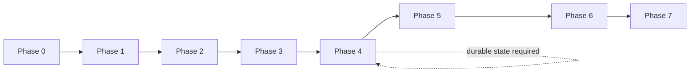

# Implementation Roadmap

| Field | Value |
| --- | --- |
| Status | Phase 0 complete; Phase 1 implemented and verified (PR #1 open for review); Phases 2–7 pending |
| Related | [Requirements](requirements.md), [Testing](testing-and-quality.md), [Release checklist](release-checklist.md) |

The phases below are the approved implementation sequence. Each phase has an
explicit objective, dependencies, deliverables, and acceptance criteria. Phase 0
does not implement Phases 1–7.

## 1. Phase Overview

| Phase | Name | Primary outcome |
| --- | --- | --- |
| 0 | Project Foundation & Engineering Standards | Specifications, scaffolding, tooling, CI, and baseline verification |
| 1 | Project Foundation Implementation | Shared CLI/logging/error/build foundation; CI operational |
| 2 | Configuration & Backend Registry | Versioned YAML loading, validation, defaults, secret resolution, `init`, `validate` |
| 3 | Health Probe & Monitoring Engine | Safe HTTP probing, criteria, scheduling, concurrency |
| 4 | Incident Lifecycle, Durable State & Notifications | Threshold state, incidents, outbox, webhook delivery, reminders, duplicate prevention |
| 5 | History, Retention & Recovery Hardening | History/status queries, retention, backup guidance, full restart and reconciliation |
| 6 | Integration, Reliability & Security Validation | E2E, failure injection, race/security/operational hardening |
| 7 | Cross-Platform Release & Documentation | Release automation, runtime platform evidence, Docker release, `v1.0.0` gates |

### Dependency adjustment for persistence

The provisional sequence placed all SQLite work after notification delivery.
Durable incident state and the notification outbox are prerequisites for correct
notification semantics, duplicate prevention, and restart behavior. Therefore:

- **Migration 1 and the transactional store slice for `backend_state`,
  `incidents`, and `notification_events` land in Phase 4**, alongside the incident
  lifecycle.
- **Phase 5 completes** observations/history queries, retention, backup guidance,
  migration hardening, and full restart/reconciliation coverage.

The phase numbers remain as approved; this is an explicit dependency adjustment,
not a silent reordering. See
[persistence.md](persistence.md) and
[incident-lifecycle.md](incident-lifecycle.md).

## 2. Phase 0 — Project Foundation & Engineering Standards

**Status:** Complete (2026-10-22). Evidence is recorded in the
[Phase 0 completion report](phase-0-completion.md).

### Objective

Establish the repository, specifications, architecture, minimal executable
bootstrap, tooling, CI, Docker design, and handoff.

### Deliverables

- Repository discovery and baseline assessment.
- Requirements, architecture, configuration, CLI, incident/notification,
  persistence, security, testing, release, and roadmap specifications.
- ADRs for decisions that materially constrain implementation.
- Go module with `version` command and tests.
- Formatting, vet, lint, race, coverage, vulnerability, and cross-build tooling.
- CI and CodeQL workflows, Dependabot, least-privilege permissions.
- Docker foundation with non-root and persistent-volume design.
- README, contributor guide, security policy, and example configuration.

### Acceptance criteria

- Actual repository state inspected; no user work discarded.
- All 15 approved decisions documented.
- YAML/SQLite responsibilities unambiguous.
- Config, CLI, incident, security, persistence, and roadmap contracts exist.
- Go module builds; `version` works; tests pass.
- Formatting, vet, lint, race, coverage, cross-build, and Docker checks executed
  and accurately reported.
- CI/CodeQL workflow syntax validated; GitHub execution limitations recorded.
- No operational monitoring feature implemented prematurely.

## 3. Phase 1 — Project Foundation Implementation

**Status:** Implemented on `feature/phase-1-project-foundation`, pushed as pull
request #1, with GitHub CI and CodeQL passing. Not merged into `develop`; review
is pending. Evidence is recorded in the
[Phase 1 completion report](phase-1-completion.md).

### Objective

Turn the Phase 0 scaffold into the shared application foundation used by all
later commands, without implementing monitoring behavior.

### Dependencies

- Phase 0 accepted.

### Deliverables

- Final CLI bootstrap patterns: root command, global flags (`--config`,
  `--log-level`), output selection, consistent help, and error-to-exit mapping.
- `log/slog` foundation: text/JSON handlers, level selection, UTC timestamps,
  stderr destination, safe-field conventions, and redaction helpers.
- Shared application error conventions and a small `internal/app` composition
  root.
- Build metadata and `--version`/`version` consistency.
- Make targets and CI refined so `make verify` and GitHub Actions reflect the
  real toolchain.
- Initial CI run on a branch, then protected `main`/`develop`.
- Documentation updates for actual command availability.

### Constraints

- Do not expose placeholder commands that imply operational functionality.
  Commands are registered when their contracts can be satisfied.
- Do not add Cobra logic to domain packages.
- Do not add dependencies beyond those justified for logging/CLI.

### Acceptance criteria

- `version` still works in text and JSON with linker metadata.
- Global flag parsing is tested, including invalid values and exit codes.
- Logs in text and JSON modes go only to stderr and contain no secrets.
- `--output json` test proves stdout remains valid JSON.
- `make check` and `make verify` pass locally.
- CI and CodeQL execute successfully on a pushed branch (or the lack of a push
  is explicitly reported).
- Documentation continues to label unimplemented commands as planned.

## 4. Phase 2 — Configuration & Backend Registry

### Objective

Implement the canonical YAML schema, strict validation, defaults, backend
registry, and secret resolution, including the `init` and `validate` commands.

### Dependencies

- Phase 1.

### Deliverables

- YAML decoder with 1 MiB limit, single-document enforcement, duplicate-key and
  unknown-field rejection.
- `version: 1` enforcement.
- `${NAME}` expansion with `$$` escaping and missing/empty-variable errors.
- Defaults application and effective per-backend policy.
- URL, header, status-code, regex, range, uniqueness, and cross-field validation.
- Secret redaction in errors and diagnostic output.
- `init` template generation and `validate` command.
- Backend registry with stable IDs.
- Unit tests for every validation rule and failure path.

### Acceptance criteria

- Valid examples load into an immutable runtime configuration.
- All invalid examples fail with exit `2`, safe field paths, and no secret values.
- Missing/empty env references fail; literal values still work.
- `validate` performs no network or database access.
- `init` refuses overwrite without `--force` and writes safe permissions.
- Config discovery precedence and relative database path resolution are tested.
- No configuration values are duplicated into a second source of truth.
- Coverage floor reaches at least 70%.

## 5. Phase 3 — Health Probe & Monitoring Engine

### Objective

Implement a safe HTTP probe engine, health criteria evaluation, per-backend
scheduling, concurrency limits, cancellation, and normalized probe results.

### Dependencies

- Phase 2 configuration and backend registry.
- Persistence slice may begin for observations/backend state, coordinated with
  Phase 4.

### Deliverables

- HTTP client with timeouts, TLS verification, response limits, redirect policy,
  header validation, and no implicit proxy.
- Accepted status evaluation and `contains`/RE2 body matching.
- Normalized result types and failure reasons.
- Per-backend scheduler with no overlapping probes.
- Global concurrency semaphore and context cancellation.
- One-shot probe execution path and scheduler tests.
- `httptest` coverage for status, body, timeout, malformed response, oversized
  body, redirect, and TLS failure cases.

### Acceptance criteria

- No probe can overlap another probe for the same backend.
- Independent backends respect `max_concurrent_probes`.
- Timeouts cancel in-flight requests and body reads.
- Oversized bodies and malformed responses produce safe failed results.
- TLS verification cannot be disabled by configuration.
- Cross-origin redirects with custom headers are rejected; redirect limit is
  enforced.
- Probes do not log headers, bodies, or secret-bearing URLs.
- Race detector passes around scheduler/probe state.
- Coverage floor reaches at least 75%.

## 6. Phase 4 — Incident Lifecycle, Durable State & Notifications

### Objective

Implement threshold-driven incidents, transactional SQLite state and outbox,
generic webhook payloads, delivery retries, reminders, and duplicate prevention.

### Dependencies

- Phase 2 and Phase 3.
- Migration 1 for `backend_state`, `incidents`, and `notification_events`
  (pull-forward from Phase 5).

### Deliverables

- Persisted failure/recovery streaks, including across one-shot runs and
  restarts.
- Incident open/close state machine with one open incident per backend.
- UUIDv4 incident/event IDs and monotonic per-incident sequences.
- Transactional observation + state + incident + outbox writes.
- Versioned webhook payloads and idempotency header.
- Notification worker with retry classification, exponential backoff, jitter,
  `Retry-After`, dead letters, and per-incident ordering.
- Reminder scheduling, cap, suppression, and cancellation on recovery.
- Per-backend notification policy.
- `check` and `monitor` core behavior and exit codes.
- Restart recovery for already-open incidents that does not duplicate Down.
- Tests for Down/Recovery, duplicate prevention, retries, and payload redaction.

### Acceptance criteria

- Sub-threshold failures create no incident and no Down alert.
- Reaching the threshold creates exactly one incident and one Down event.
- Repeated failures do not duplicate Down.
- Recovery threshold closes exactly once and emits one Recovery.
- One open incident per backend is enforced under concurrency.
- Crash between transition and delivery leaves a durable pending event.
- Restart while down emits no duplicate Down; restart while recovered emits one
  Recovery based on observed health.
- Reminder behavior matches the incident contract, including no backlog flood.
- Payloads contain no headers, URLs, secrets, or response bodies.
- Notification failures are durable and do not corrupt incidents.
- `check`/`monitor` return documented exit codes and preserve JSON discipline.
- Coverage floor reaches at least 80% overall and in core packages.

## 7. Phase 5 — History, Retention & Recovery Hardening

### Objective

Complete persistence-facing commands and operational data management.

### Dependencies

- Phase 4 durable state.

### Deliverables

- Observations table and query paths.
- `status` command for backend state and open/orphaned incidents.
- `history` command with filters, limit, and JSON output.
- Retention job and tests for age boundaries, open incidents, and pending events.
- Consistent backup/restore guidance (and a command only if justified).
- Migration hardening, schema-version errors, corruption handling, and rollback
  tests.
- Full restart reconciliation harness, including stale delivery reset and partial
  persistence.
- Read-only database behavior for status/history.
- SQLite permission and Docker volume persistence tests.

### Acceptance criteria

- Status and history never probe or mutate state.
- Filters, limits, `has_more`, and empty-database behavior are tested.
- Orphaned incidents are visible and never auto-closed or reminded.
- Retention never deletes open incidents, pending events, or current state.
- Schema newer than the binary fails closed with upgrade guidance.
- Corrupt databases are never overwritten.
- Restart preserves open incidents, streaks, reminders, and pending deliveries.
- Stale `delivering` rows are reset without losing the event.
- Docker data survives container recreation.
- Race and permission tests pass.

## 8. Phase 6 — Integration, Reliability & Security Validation

### Objective

Prove the integrated product under realistic and adversarial failure conditions.

### Dependencies

- Phases 2–5.

### Deliverables

- End-to-end tests using the built binary, local HTTP servers, a fake webhook,
  and temporary SQLite.
- Failure injection: DNS failure, connection refusal, timeout, TLS failure,
  malformed response, oversized body, webhook 4xx/429/5xx, retry exhaustion.
- Restart and crash-window simulations.
- Concurrency stress tests with `-race`.
- Redaction tests across logs, errors, JSON, and payloads.
- Resource lifecycle checks: goroutine leaks, response body closure, DB closure.
- Security review findings and fixes.
- Operational checks: graceful shutdown, signal handling, read-only container,
  non-root, persistent volume.
- Coverage and quality ratchet review.

### Acceptance criteria

- All documented failure scenarios have deterministic automated evidence.
- No secret appears in any captured output or payload.
- Shutdown completes within the configured timeout with no leaked resources.
- `go test -race ./...` passes repeatedly.
- `govulncheck` has no unresolved reachable findings, or each is documented with
  a reviewed exception.
- CodeQL has no unresolved high-severity findings.
- Docker runs with the recommended hardening flags and persists data.
- Release checklist gaps are listed explicitly.

## 9. Phase 7 — Cross-Platform Release & Documentation

### Objective

Prepare and validate the `v1.0.0` release without weakening any approved gate.

### Dependencies

- Phase 6 complete; all release gates have evidence.

### Deliverables

- Release automation (GoReleaser or a reviewed equivalent) with reproducible
  builds, checksums, and declared platform artifacts.
- Multi-arch container release and digest pinning.
- Runtime validation on Linux amd64/arm64, Windows amd64, macOS amd64/arm64.
- SBOM and image/artifact vulnerability scan.
- Signing/provenance decision and implementation if approved.
- Complete English README, command reference, configuration reference, examples,
  security notes, and upgrade/backup instructions.
- Changelog and release notes.
- Final security review and release checklist evidence.
- Published `v1.0.0` only after all gates pass.

### Acceptance criteria

- Every item in [release-checklist.md](release-checklist.md) is checked with
  evidence.
- Artifacts are reproducible from a clean checkout with documented toolchains.
- Each declared platform has runtime evidence, not only compilation.
- Docker data persistence and signal handling are validated.
- Documentation matches the released behavior and labels no unimplemented
  features.
- No unresolved critical/high security issue.
- Release is published only with explicit project-owner authorization.

## 10. Phase Dependencies at a Glance

The self-dependency is intentional documentation of the persistence slice: the
transactional store is part of Phase 4, not deferred to Phase 5.

## 11. Phase 0 Handoff Notes

The next phase can begin without rediscovering these decisions:

- Module path, binary name, license, owner, and Go version are fixed in
  [requirements.md](requirements.md) and the repository metadata.
- Configuration and persistence have separate, canonical contracts.
- The CLI surface and exit codes are frozen for v1.
- Incident/notification semantics and duplicate-prevention strategy are explicit.
- Security and secret-handling rules apply to every future output path.
- CI, Docker, and release gates are defined, with Phase 0 verification evidence
  reported separately.

Known Phase 0 limitations are recorded in the completion report: `govulncheck`
could not reach the vulnerability database locally, CI/CodeQL cannot execute
without a push, and runtime validation of non-Linux targets is deferred to
release.

## 12. Recommended Next Task

**Phase 1 — Project Foundation Implementation.**

Scope:

- global CLI flags and shared error/exit conventions;
- `log/slog` foundation with safe field conventions;
- build metadata consistency;
- app composition skeleton;
- CI execution on a branch;
- documentation updates.

Do not implement configuration loading, probing, incidents, notifications,
SQLite, or operational commands in Phase 1 beyond what is necessary to prove the
shared foundation.
